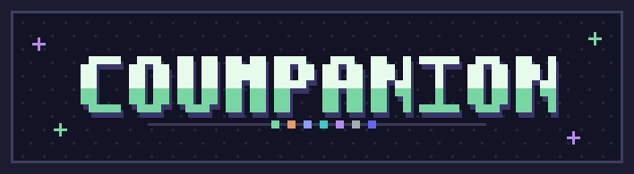
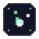

# Coumpanion

<p align="center">
  
</p>

<p align="center"><strong>All your AI. One island.</strong></p>

Coumpanion keeps your AI sessions in a Dynamic Island on Android. Start a timer, switch apps, and tap the island whenever you want to check elapsed time, reopen a provider, or stop a session. Manual tracking runs on your phone without an account, API key, or server.

<p align="center">
  <a href="https://github.com/Neyoiooo/coumpanion/releases/tag/coumpanion-v0.6.0-preview.1"><strong>Get the Android preview</strong></a>
  ·
  <a href="android/README.md">Setup and installation</a>
</p>

##  Meet Coupi

<p align="center">
  
  
  
</p>

Coupi is the little robot that lives in your island. Equip an AI and Coupi takes on its colors. The round badge on its belly shows which AI it has equipped. When several sessions are open, expand the island to see each one.

The gallery shows the avatar system on `main`. The download links below point to the signed Android preview.

##  Coupi’s states

| Coupi | State and equipped AI | What the island is telling you |
| :---: | --- | --- |
|  | **Idle** · Unequipped | Coupi is at rest. |
|  | **Tracking** ·  ChatGPT | Your manual timer is running. Only elapsed tracking time is confirmed. |
|  | **Thinking** ·  Claude | A paired desktop agent reported that it is thinking. |
|  | **Working** ·  Gemini | A paired desktop agent reported work in progress. |
|  | **Completed** ·  Codex | A paired desktop agent reported completion. Coupi celebrates briefly and returns to idle. |
|  | **Waiting for approval** ·  Muse | A paired desktop agent needs your response. |
|  | **Error** ·  DeepSeek | An integration reported a problem. |
|  | **Disconnected** ·  Grok | The desktop link is offline. |

<p align="center">
  
  
  <br>
  <strong>
     Perplexity
    ·
     Copilot
  </strong>
</p>

The pairings illustrate how the palettes and motions combine. The island shows states supported by each session’s activity source. Full edition’s optional notification watching shows updates reported by the source app.

##  Install on Android

Both editions require **Android 11 or later**. Pick an AI in **Choose AI apps**, start tracking, then give Coumpanion permission to display the island over other apps.

| Edition | What’s included | Signed preview |
| --- | --- | --- |
| **Standard** | Manual tracking, Dynamic Island, widgets and optional desktop pairing | [Download Standard APK](https://github.com/Neyoiooo/coumpanion/releases/download/coumpanion-v0.6.0-preview.1/Coumpanion-Android-0.6.0-Standard.apk) |
| **Full** | Standard features plus optional notification watching | [Download Full APK](https://github.com/Neyoiooo/coumpanion/releases/download/coumpanion-v0.6.0-preview.1/Coumpanion-Android-0.6.0-Full.apk) |

Both editions can use DeepSeek through the optional Coumpanion Server. The server holds your DeepSeek API key. [Set up the server from your phone](android/server/README.md#from-your-phone) · [Browse releases](https://github.com/Neyoiooo/coumpanion/releases)

##  Build from source

Use JDK 17, Android SDK platform 36, and Node.js.

```bash
cd android
./gradlew test assembleDebug lint
node scripts/gen-strings.mjs --check
```

[Android development and avatar system](android/README.md) · [Phone link protocol](docs/ANDROID_LINK.md)

## Credits

Coumpanion is based on Louis Raillé’s Coucou and Rhytam Biswas’s Android port. The code is open source under the MIT License. [Upstream project](https://github.com/Louis-CFM/coucou) · [MIT license](LICENSE) · [Android license](android/LICENSE) · [Artwork and provider logo notices](LICENSE-ASSETS.md)
